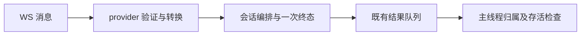

# Context

目标：关闭/切换输入框、服务端响应异常时不带崩 fcitx5，会话失败有可观察终态并可回收。历史 core 指向主线程 ClearUI；本地公开 activate/deactivate 与真实 WS 收包分别复现 SIGSEGV/Json::LogicError → SIGABRT。用户批准继续修复这两项，不迁移 WS 库或安装产物。

# Design

- UI：长期裸指针改为 Fcitx watch 引用，仅主线程访问；generation 只检查结果归属。worker 投递 generation/值数据，主线程再检查引用。deactivate 同步提交并清空原输入框后解除引用，防止文本跨输入框继承；pipeline 延迟停止契约不变。使用旧版也提供的 watch/get，不要求 scheduleWithContext。
- 协议：Realtime/豆包各自校验根对象、已知字段与整数范围，转换为不含 JsonCpp 的 ServerEvent/ServerResponse。豆包结果数组嵌套最多 16 层，解压仍有 16MB 上限。可空字段、扩展事件、空确认帧保留；非法 gzip/已知字段立即失败，不重连且不提交已有 partial。
- 会话：共用最外层异常边界与 curl/header RAII；zlib 在异常退出时也回收。错误 callback 抛异常不能逃逸，final 在调用 callback 前标记且不重试；异常诊断记录类别/sessionId，不使用 what()。所有退出设置 finished/workerDone，取消不补发错误终态。
- 依赖方向：主线程引擎 → pipeline 公开回调；会话编排 → provider 协议与已有 WS transport。协议 JsonCpp 对象仅在解析边界内使用，不进入 UI 或会话可变状态。不增加网络/事件循环框架。

# Failure Modes

| Failure | Handling |
|---|---|
| 输入框销毁 / generation 过期 | 主线程不更新或提交该结果 |
| 已知事件字段错误 / 非法 JSON / gzip | 固定协议错误 + 一次空 final，退出并回收 |
| worker / callback 抛异常 | 隔离、记录类别、独立尝试通知与终态，workerDone 必须完成 |
| 正常 Realtime error | 可观察错误但不推进 commit 计数、不强制结束 |
| 缺少运行期 curl WS | 新协议测试明确 SKIP，不能视作通过；本轮不修库兼容性 |

# Rollout

拆成 UI 修复、纯协议抽取、共享测试夹具、Realtime 修复、豆包修复等独立提交；本地 Release 与 sanitizer 已验收，推送修复分支后由草稿 PR 触发 CI，主分支不合并、无安装/发布。详细取舍见 [UI ADR](../../../docs/03-architecture/adr/ADR-0002-input-context-lifetime.md) 与 [WS ADR](../../../docs/03-architecture/adr/ADR-0003-ws-session-failure-boundary.md)。

# Rollback

无数据迁移或外部契约变更，可按职责撤销修复提交；后续共用资源的豆包修复需先于 Realtime 基础边界撤销。回滚会恢复对应崩溃风险，不应为避开测试而回退。
