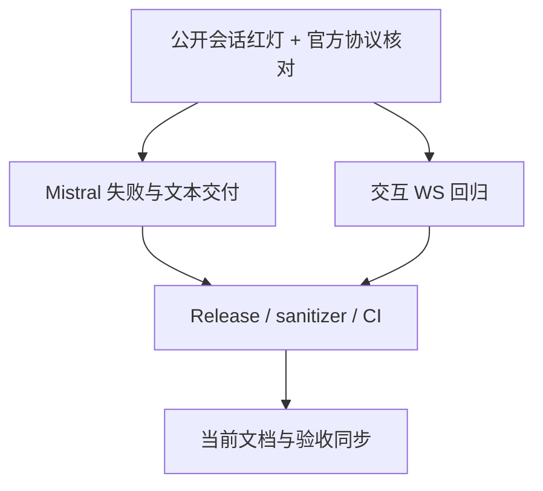

# Preparation

## Parallel Execution Strategy

- Sequential Baseline: 用户握手日志、本地协议复现与旧实现快照。
- Parallel Slices: Mistral 生产代码与测试分别维护，独立只读失败路径评审。
- Convergence & Verification: 本地全套、sanitizer、文档门禁与远端 CI；不安装、不合并。

- [x] 保存未修复实现并核实官方 SDK 固定提交；`text: []` SIGABRT 已复现。

# Tasks

## Task 1: Mistral 失败与文本交付
- Builds: HTTP 拒绝保留诊断、正常推流与一次终态、不崩溃宿主。
- Blocked By: Preparation
- Parallel Group: Group 1
- Verification: `ctest --test-dir /tmp/opencode/fcitx5-mistral-release --output-on-failure`
- [x] Provider 协议验证、HTTP 状态码、created 时序、End flush/end、done 权威全文。
- [x] 公共 worker 边界与 curl/header RAII，final 回调前标记。

## Task 2: 会话回归与收敛
- Builds: 公开会话可重复红/绿与取消/异常验收。
- Blocked By: Preparation
- Parallel Group: Group 1
- Verification: `ctest --test-dir /tmp/opencode/fcitx5-mistral-asan --output-on-failure`
- [x] 新交互式 Mistral 回归：旧实现 16 失败/1 合法取消对照通过（含 5 个 SIGABRT），修复后 17/17 通过。
- [x] 既有 28/28 Release 与 Debug ASan/UBSan 全套通过，无跳过。
- [x] 非读 socket 夹具发送 created，继续覆盖真实音频背压。
- [x] 更新 ADR-0004、跟进任务与测试清单。

# Verification

- [x] 汇合后全套 Release 与 Debug ASan/UBSan 均 45/45，无失败、无跳过。
- [x] 文档站 `pnpm --dir docs run build` 通过。
- [x] 可独立回滚 provider 与对应测试，无迁移，无安装。

本地 Cabbage 门禁与远端 CI 结果在提交前/推送后分别核实，远端结果记录于 PR，不提前宣称通过。云端账户故障仍待用户人工复测。
