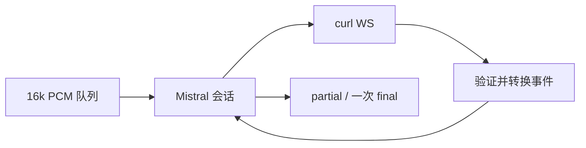

# Context

## Current State

HTTP 握手拒绝会重试并被 End 取消错误覆盖；错误事件读取顶层 message 而不是 error.message，不交付终态；text 数组可令 JsonCpp 异常越过线程并 SIGABRT。官方 SDK 来源固定为 client-python@6229ed96cb5bfcfc9068a11dee5ff357697a8ad9。

## Goals and Non-goals

- Goal: 握手错误可诊断、正常文本正确交付、异常不得终止宿主且一次终态。
- Non-goal: WS 库迁移、其他 provider、构造/启动失败（CRASH-ASR-002）、旧 curl WS 能力补齐。

# Requirements

| ID | Technical requirement | Source |
|---|---|---|
| TR-1 | 安全状态码诊断、永久拒绝不重试、End 不覆盖前一失败 | 用户日志 |
| TR-2 | 官方协议类型与会话初始化、最终文本语义 | 官方 SDK |
| TR-3 | 回调异常不逃逸，一次 final，有界资源回收 | ADR-0003 / CRASH-ASR-001 |

# Design

## Overview

`mistral_protocol.h` 负责无 I/O 的构建和验证；`MistralAsrSession` 负责连接、等待创建、推流、flush/end 与结果。依赖方向为 session → provider protocol / 已有公共 worker 与 curl RAII → curl/JsonCpp。

## Interfaces and Data

AsrSession 契约不变。等待 session.created 后才发 update/audio；End 先发余音频，再 flush、end。segment 替代对应段的 delta；done.text 为该连接权威全文，不做 substring 去重。取消无终态；协议非法为空 final；传输中断/End 超时可交付已累积文本。已知字段验证后转换，未知事件与字典型 error.message 合法。End 不再重连。

# Alternatives

| Option | Benefits | Costs and risks | Decision |
|---|---|---|---|
| 仅打印 HTTP 状态码 | 最小诊断改动 | 留下已复现崩溃和收尾缺陷 | 不足 |
| Provider 修正并复用失败边界 | 无新依赖，隔离根因 | 需会话级回归 | 采用 |
| 迁移 WS 库 | 可能改善旧平台能力 | 不能修应用协议，扩大范围 | 后续独立议题 |

# Security and Privacy

HTTP 只输出状态码与固定提示；服务端错误只输出固定文本与数值 code。不记录地址、headers、原始响应、error.message、语音或异常 what()。本地夹具仅使用 test-key。

# Observability

| Signal | Purpose | Alert or dashboard |
|---|---|---|
| HTTP 状态码、attempt、sessionId | 区分拒绝与 End 控制流 | Fcitx 日志 |
| 固定协议错误 / workerDone / final | 诊断失败与资源收敛 | 会话回归 |

# Failure Modes

| Failure mode | Detection | Handling | Recovery |
|---|---|---|---|
| 401/403/404 | HTTP 状态码 | 一次错误与空 final，不重试 | 检查账户、端点或模型 |
| 非法字段/回调异常 | 验证/worker 边界 | 一次空 final、RAII、完成标记 | 新会话 |
| EOF/End 超时 | WS 事件/预算 | 已累积文本 final，不挂起 | 新会话 |

# Rollout

先本地红/绿与 Release/sanitizer 回归，再独立 PR 与七发行版 CI。无安装、无自动合并。

# Rollback

回滚本项生产代码与对应测试即可，公共 worker/curl 资源模块不变，无数据迁移。

# Open Questions

- 用户云端握手拒绝的具体状态码待更新版本后人工复测（用户/维护者）。
