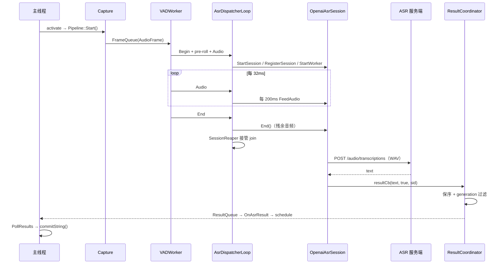
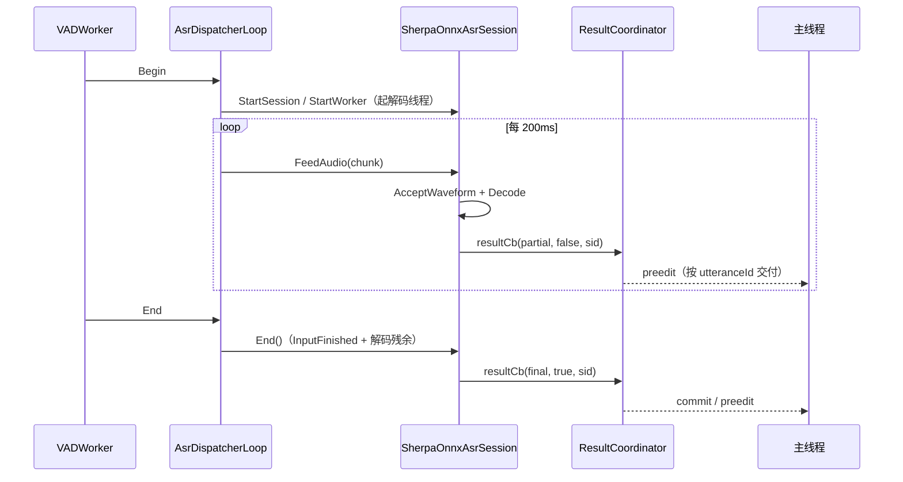

# fcitx5-voice-input 运行时调用序列

> **状态:** 当前实现文档（与 `src/addon/` 同步，含本地 Sherpa 后端）。
> **关联:** [总体架构](index.md)、[组件详述](component-details.md)、[v4 会话模型](v4-asr-session-model.md)。
> **目的:** 把「录音 → VAD 分段 → ASR 转写 → LLM 后处理 → 提交文本」按线程与时间轴展开，便于排查时序问题。

---

## 1. 一句话链路

```
麦克风 ─▶ Capture ─▶ FrameQueue ─▶ VADWorker ─▶ SpeechEventQueue ─▶ AsrDispatcherLoop
                                                                        │
                                          ┌─────────────────────────────┘
                                          ▼
                              AsrSession worker ×N（云端 WS/HTTP 或本地 sherpa）
                                          │ resultCb(text, isFinal, sessionId)
                                          ▼
                          ResultCoordinator（generation 过滤 + 按 utteranceId 保序 + LLM）
                                          │ ResultQueue
                                          ▼
                    主线程 eventDispatcher ─▶ PollResults() ─▶ commitString() / preedit
```

两个标识贯穿全链路：

- `generation`：每次激活/停用递增。旧 generation 的结果在 `ResultCoordinator` 和主线程都会被丢弃。
- `utteranceId`：每段语音递增。并发会话的最终结果按它保序上屏。

---

## 2. 线程与队列

| 线程 | 职责 | 关键约束 |
|---|---|---|
| **主线程** | Fcitx5 事件循环、`eventDispatcher`、`PollResults`、UI 更新 | 只做队列读取与上屏，禁止阻塞 |
| **Capture** | Pulse：1 个阻塞读线程（`pa_simple_read`）。PipeWire：`on_process` 回调 + `DrainLoop` 线程 | `on_process` ≤100μs，只写 ring buffer；取帧受 delivery gate 控制 |
| **VADWorker** | 消费 `FrameQueue`，跑 Silero ONNX，产出 `SpeechEvent` | 独立 Idle/Speaking 状态机 |
| **AsrDispatcherLoop** | 消费 `SpeechEventQueue`，起停会话、按 200ms 批量喂音频 | 唯一创建/回收会话的位置 |
| **Session worker × N** | 每个活跃会话一个后端线程（HTTP、WS 或本地解码） | 并发上限 3，超限取消最旧会话 |
| **SessionReaper** | 后台 `JoinWithTimeout(15s)` 回收会话线程 | 不阻塞分发线程与主线程 |
| **LLM** | 无独立线程：`Process`/`ProcessStream` 在会话 worker 内同步调用 | 30s 超时；按 generation 取消 |

| 队列 | 类型 | 容量 | 说明 |
|---|---|---|---|
| `frameQueue_` | `ThreadSafeQueue<AudioFrame>` | 1024 帧（≈32s） | 溢出丢最旧 |
| `speechEventQueue_` | `ThreadSafeQueue<SpeechEvent>` | 256 事件 | 溢出丢最旧 |
| `pendingAsrAudio_` | `std::vector<float>` | — | 分发线程内 200ms 批量缓冲 |
| `resultQueue_` | `ThreadSafeQueue<AsrResult>` | 无界 | 终态由 `ResultCoordinator` 保证不丢 |
| PipeWire ring buffer | lock-free SPSC | 秒级 | 仅音频回调线程写、`DrainLoop` 读 |

---

## 3. 阶段 0：激活（主线程）

```
activate(entry, event)
├── InitializeIfNeeded()            # 仅首次
│   ├── pipeline_->Init(config)     # VAD 参数
│   ├── ReloadActiveAsrClient()     # CreateAsrEngine() + engine->Init()
│   │   └── 失败时保留 nullptr / 旧引擎
│   └── SetLLMClient(...)           # 启用且配置了模型时
├── generation = ++activeGeneration_
├── pipeline_->SetGeneration(generation)
└── pipeline_->Start()
    ├── 复用保留的 capture；不可用则重新 StartCapture()（Pulse → PipeWire fallback）
    ├── frameQueue_.Clear() / speechEventQueue_.Clear()
    ├── results_->Start(utteranceCounter_ + 1, generation)
    ├── vadWorker_->Start()         # 失败则 Stop() 回滚
    ├── asrThread_ = AsrDispatcherLoop
    └── capture_->SetDeliveryEnabled(true)
```

`Init` 的耗时（模型加载、网络客户端初始化）会被记录为 `stage=engine.activate` 的 `init_ms`；它发生在主线程，因此本地大模型首次激活会表现为一次可感知的停顿。

---

## 4. 阶段 1：采集与 VAD 分段

音频格式统一为 **16kHz mono / int16 / 512 samples（32ms）**。

```
Capture 线程
├── Pulse：pa_simple_read → AudioFrame → DeliverFrame(epoch)
└── PipeWire：on_process → ring buffer → DrainLoop → AudioFrame → DeliverFrame(epoch)
                                                   │
                                                   ▼
                                             FrameQueue
                                                   │
VADWorker                                         ▼
├── TryPop(frame) 每 32ms
├── Silero.predict(pcm) → probability
├── Idle：prob ≥ speechThreshold 连续 startFrames → Speaking
│   ├── Push SpeechEvent{Begin}
│   ├── Push SpeechEvent{Audio, pre-roll}   # 最多 preRollMs
│   └── Push SpeechEvent{Audio, 当前帧}
├── Speaking：每帧 Push SpeechEvent{Audio}
└── 结束条件
    ├── 静音 ≥ endSilenceMs → 时长 ≥ minSpeechMs ? Push{End} : Push{Cancel}
    └── 时长 ≥ maxSpeechMs  → Push{End}
```

`SetDeliveryEnabled(false)` 用 epoch 奇偶切换取帧门闸：失焦后立即停止向识别链路提交新帧，但不关闭音频流。

---

## 5. 阶段 2：ASR 分发（AsrDispatcherLoop）

| 事件 | 处理 |
|---|---|
| `Begin` | 1) 取消旧会话（`SkipSession` + `Cancel` + 交 reaper）<br>2) `utteranceId = ++utteranceCounter_`<br>3) `engine->StartSession()`；容量 3 已满时引擎同时返回被取消的最旧 `sessionId`，此处 `SkipSession`<br>4) `RegisterSession(sessionId, {generation, utteranceId})`<br>5) `session->StartWorker()` |
| `Audio` | int16 → float，累计到 200ms（3200 samples）后 `FeedAudio()`；`End` 时补发剩余部分 |
| `End` | `FeedAudio` 残余 → `session->End()` → 交给 `SessionReaper` |
| `Cancel` | `SkipSession` → `session->Cancel()` → 交给 `SessionReaper` |
| 空闲 | 每 5ms 轮询队列；每 500ms 调 `results_->ExpireStale()` 放行卡死的队首语音段 |

`Begin` 时持有 `engineMutex_` 直到会话登记与 worker 启动完成，避免配置热切换与 `StartSession` 交叉。

---

## 6. 阶段 3：各后端会话内部

| 后端 | 传输 | worker 启动 | 增量结果 | 终态 |
|---|---|---|---|---|
| `openai`（whisper） | HTTP multipart WAV | `End()` 时起线程 | 无 | 请求返回一条 final |
| `openai`（chat） | HTTP JSON + base64 | `End()` 时起线程 | 无 | 一条 final |
| `openai`（realtime） | WebSocket | `StartWorker()` 建连 | delta → `isFinal=false` | `completed` → final |
| `volcengine` | WebSocket 二进制（gzip） | `StartWorker()` 建连 | `utterances` 增量 | `isFinal` 事件 → final |
| `mistral` | WebSocket | `StartWorker()` 建连 | 增量文本 | flush/End → final |
| `sherpa_onnx` | 本地进程内 | `StartWorker()` 起线程 | 每 200ms 解码，文本变化即发 partial | `End` → flush → final |
| `sherpa_offline` | 本地进程内 | `StartWorker()` 起等待线程 | 无 | `End` 唤醒 → 整段解码 → 一条 final |

共同约定：

- `FeedAudio` 只做入队/缓冲，不做 IO 或推理。
- `StartWorker()` 必须由分发线程在会话登记后调用一次。
- `End()` 表示音频结束，允许后端在 worker 内继续收尾。
- `Cancel()` 是协作式的：本地解码在开始前检查取消标志；HTTP 通过进度回调中止传输；WS 由 `WsDeadline` 预算收敛，`End` 后不再重连。

### 6.1 本地流式（`sherpa_onnx`）

```
StartWorker → 线程循环
├── Pop 音频块（200ms）
├── AcceptWaveform(stream, chunk)
├── while IsReady(stream): Decode(stream)
├── GetResult(stream) 有变化 → resultCb(text, false, sid)
└── End：InputFinished → 解码残余 → resultCb(final, true, sid)
```

### 6.2 本地离线（`sherpa_offline`）

```
StartWorker → 线程阻塞等待
├── 等待 End()/Cancel()
├── Cancel：直接退出，不发终态
└── End：整段 AcceptWaveformOffline → Decode → GetResult
    └── 一条 resultCb(text, true, sid)
         └── 空音频/空结果也发 final，避免保序闸门等到 40s 停滞放行
```

X-ASR 为非流式模型，整段解码才有结果；断句完全由 VAD 负责。

热词（`hotwords_file`）按模型词表形态编码：词表含裸汉字时用 `cjkchar`；只有 `▁汉字`（X-ASR）时用 `bpe`，并把连续汉字逐字拆词后写入 `~/.cache/fcitx5/voice-input/hotwords-bpe.txt` 再交给 sherpa（否则第二个汉字起会编码成 `<unk>`）。热词文件缺失或无法生成时自动退回 `greedy_search`。

---

## 7. 阶段 4：结果汇聚（ResultCoordinator）

回调来自会话 worker 线程：`HandleAsrResult(text, isFinal, sessionId)`。

```
TakeContext(sessionId)
├── accepting == false 或 sessionId 未登记 → 丢弃
└── isFinal 时同时移除会话登记
      │
      ├── partial：Submit(partial, terminal=false)
      └── final
          ├── text 为空 → Submit(isError=true, terminal=true)   # 主线程提示「语音识别失败」
          └── text 非空
              ├── 无 LLM：Submit(raw, terminal=true)
              └── 有 LLM：Submit(raw, terminal=true) + Refine(...)
                  ├── 非流式：Process() 30s 超时，回调或兜底 final
                  └── 流式：ProcessStream() 增量 preedit + final
```

`OrderedResultBuffer` 以 `utteranceId` 为序键：

- 队首未终结时只交付其已缓存的 partial（preedit 需要立即可见），闸门不前进；
- 某段停滞超过 **40s** 时丢弃其缓存，改下推一条超时错误结果并推进闸门（issue #43）；
- 旧 generation 的结果在 `Submit` 入口被丢弃。

交付时 `resultQueue_.Push(...)`，并通过回调（`Pipeline::SetResultCallback` → `VoiceInputEngine::OnAsrResult`）通知主线程。

---

## 8. 阶段 5：主线程上屏

```
OnAsrResult(text)
└── eventDispatcher_.schedule → generation 校验 → PollResults()
    └── while (ResultQueue.TryPop(result))
        ├── 无效结果（generation 不符 / 无 activeIc）→ 丢弃
        ├── isError → 清空 preedit + 状态「语音识别失败」
        ├── isLLMRefined
        │   ├── partial 且 utteranceId 匹配 → 原地更新 preedit
        │   └── final 且 utteranceId 匹配 → commit + 清空 pending
        └── 原始 ASR
            ├── partial → 更新 preedit / 状态区
            └── final
                ├── LLM 启用 → preedit +「修正中...」，等待 refine
                └── 未启用 LLM → 按后端 autoCommit
                    ├── true：commitString + 清空 status
                    └── false：保留为 preedit
```

`autoCommit` 按当前后端读取：`openai` / `sherpa_onnx` / `sherpa_offline` 各有子配置；其余后端沿用默认值。任意按键会把 pending preedit 提交（`keyEvent`）。

---

## 9. 阶段 6：停用与配置热切换

| 触发 | 路径 | 行为 |
|---|---|---|
| 失焦 `InputContextFocusOut` | `DeactivateContext(true)` | `Pause()`：关取帧门闸 → `results_->Pause()` → VAD 停止 → 分发线程 join → 取消当前会话 → `CancelAllSessions()` → 清空队列；**保留录音流** |
| 切换输入法 / 输入法组变更 / IC 销毁 | `DeactivateContext(false)` | `Stop()`：`Pause()` 后释放录音流 |
| `setConfig` / `setSubConfig` | `ReloadActiveAsrClient()` | 新建引擎并 `Init`；成功才替换；替换时 `SkipAllSessions` + 旧引擎 `CancelAllSessions`；失败保留旧引擎 |

停用会递增 `activeGeneration_` 并把 `sessionGeneration_` 置 0，此后到达的任何结果都会被过滤。

---

## 10. 时间预算与失败边界

| 路径 | 预算 | 作用 |
|---|---|---|
| `SessionReaper` join | 15s | 超时丢弃会话线程，不阻塞清理 |
| 会话析构 join | 2s（sherpa）/ 5s（openai） | 正常路径快速回收 |
| WS 发送单次预算 | 10s | 上游不读 socket 时失败 |
| WS `End` 总预算 | 8s | 保证收尾路径在 reaper 的 15s 内收敛 |
| Realtime 空闲超时 | 5s | End 后服务端无响应，以累积文本兜底 final |
| LLM 请求 | 30s | 超时后兜底提交原始文本 |
| 保序闸门停滞 | 40s | 单段卡死时以错误结果放行，避免后续全被扣住 |

---

## 11. 两张时序图

### 11.1 云端批量（OpenAI whisper）



### 11.2 本地流式（sherpa-onnx）



---

## 12. 与文档的关系

- 静态结构与设计取舍见 [ARCHITECTURE](index.md)；
- 各组件接口与实现细节见 [组件详述](component-details.md)；
- `AsrSession` 抽象与回收语义见 [v4 会话模型](v4-asr-session-model.md)。
